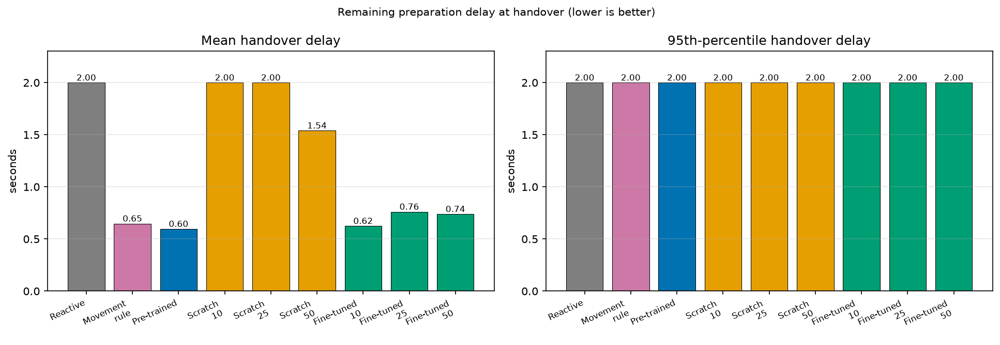
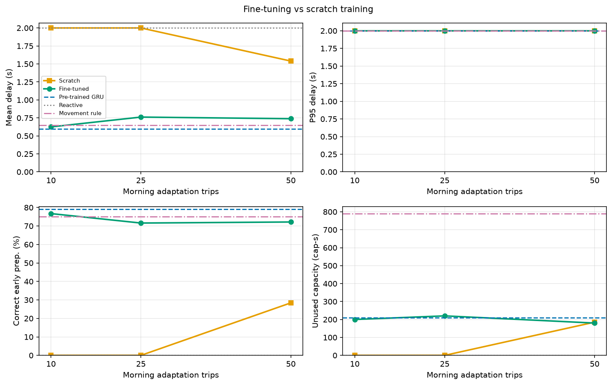

# AI-Driven Campus Mobility Prediction

## What we did

Simulated campus users moving between four cells and compared nine handover approaches, including reactive, movement-rule, pre-trained GRU, scratch GRU, and fine-tuned GRU models.

## How we did it

- Pre-trained a GRU on 300 general trips, then fine-tuned it on 10, 25, and 50 morning trips. Scratch models used the same morning trips.
- Used five consecutive readings to predict the serving cell three seconds ahead, with one probability per cell. Training, validation, and test sets contain separate whole trips.
- Simulated advance reservations with capacity 10 per cell, a 2-second preparation delay, and 5-second reservation expiry. Confidence thresholds were selected on validation trips.
- Evaluated all approaches on the same 100 held-out trips and 176 handovers. Two complete integration runs produced identical results.

## Results

| Approach | Mean delay (s) | Unused capacity (capacity-seconds) |
|---|---:|---:|
| Reactive | 2.000 | 0 |
| Movement rule | 0.648 | 790 |
| Pre-trained GRU | 0.597 | 210 |
| Fine-tuned GRU, 10 trips | 0.625 | 200 |

Fine-tuning beat scratch training at every budget. The general pre-trained model achieved the lowest mean delay. P95 delay remained 2 seconds for all approaches.





Full results are in [test_comparison.csv](integration_results/test_comparison.csv).

## Challenges

- Most readings stay in the same cell, so overall prediction accuracy can hide missed cell changes.
- Wrong predictions occupy reservation capacity, creating a trade-off between delay and unused resources.
- Windows NumPy DLL errors required pinning NumPy to 2.4.4.
- One-second sampling limits timing precision. Sub-second handover events and the campus-map demo remain pending.

## Run

```powershell
python -m venv .venv
.\.venv\Scripts\python.exe -m pip install -r requirements.txt
```

Select the `.venv` Python kernel and Run All from this folder, in order.

1. `train_model.ipynb` generates data and trains the models.
2. `handover_simulator.ipynb` runs the handover baselines and demo.
3. `main.ipynb` compares all approaches and checks reproducibility.

Outputs go to `data/`, `artifacts/`, and `integration_results/`.
